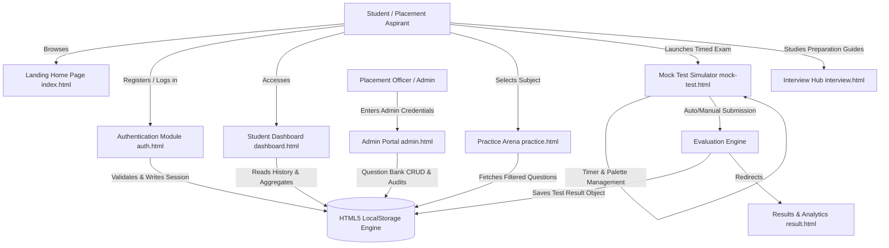
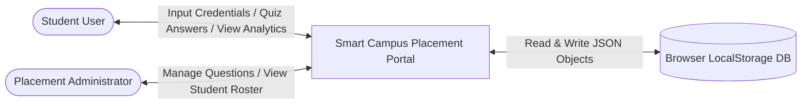
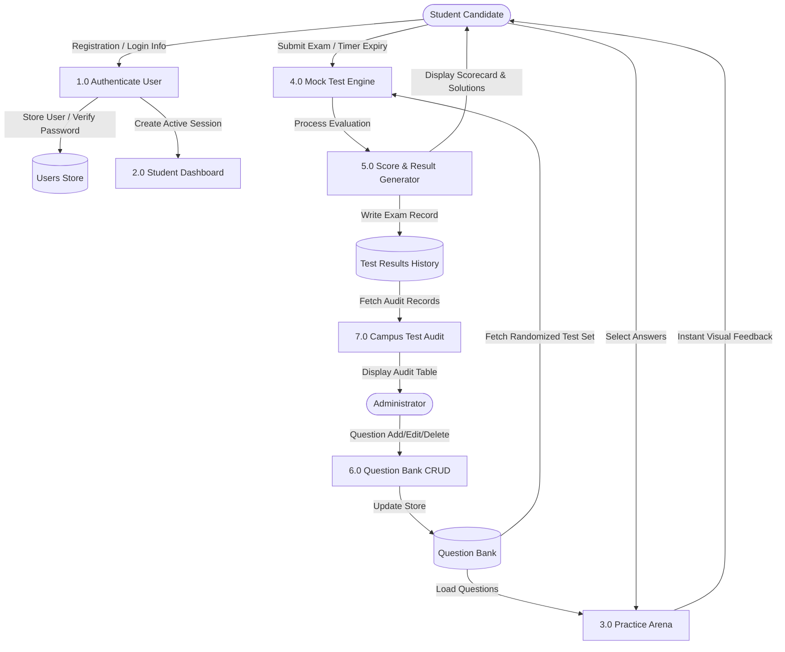
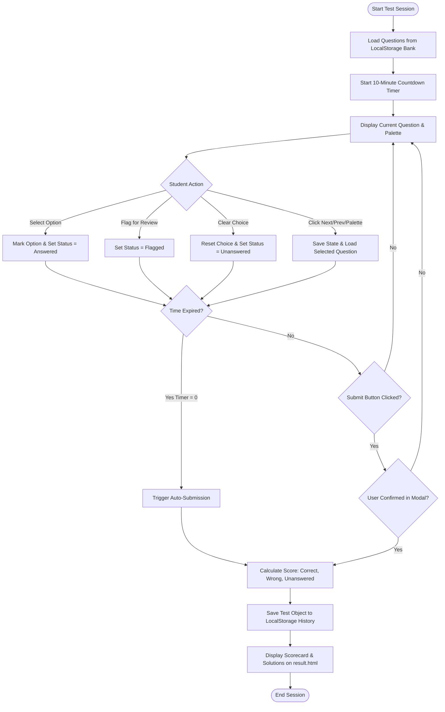

# ACADEMIC PROJECT REPORT
## SMART CAMPUS PLACEMENT PREPARATION PORTAL
**A Summer Project Submitted in Partial Fulfillment of the Requirements for the Award of the Degree of**  
**BACHELOR OF COMPUTER APPLICATIONS (BCA)**

---

## 1. Project Abstract
Campus placements represent a critical milestone in undergraduate computer application studies. However, most students face challenges navigating fragmented practice material, absence of real-time timer simulations, and lack of personalized diagnostic feedback. 

The **"Smart Campus Placement Preparation Portal"** is an integrated web-based preparation system engineered using semantic HTML5, modern responsive CSS3, vanilla JavaScript (ES6+), and HTML5 LocalStorage. The portal provides comprehensive preparation across four recruitment tracks: Quantitative Aptitude, Logical Reasoning, Verbal Ability, and Core Technical Programming (C, Java, Web technologies). 

Key innovations include an interactive Practice Arena with step-by-step mathematical explanations, a 10-minute Timed Mock Test Engine with dynamic color-coded question palette navigation and automatic submission, automated diagnostic scorecards with personalized improvement recommendations, an Interview Preparation Hub with STAR method project guidance and Group Discussion (GD) frameworks, and an Administrative CRUD console for institutional question bank management. The system operates completely client-side without recurring backend infrastructure costs.

---

## 2. Introduction
In today's highly competitive IT employment landscape, companies such as TCS, Infosys, Wipro, Cognizant, and Accenture assess candidates on strict criteria combining numerical aptitude, analytical reasoning, communication skills, and computer science fundamentals. 

Traditional preparation methods involving heavy textbooks and disjointed question banks often fail to build examination time-management skills. Students rarely receive immediate feedback on their weak subject areas before the actual placement drive.

The Smart Campus Placement Preparation Portal bridges this gap by offering a simulation platform tailored to university curriculum standards. It empowers students to evaluate their preparedness, identify weak topics, and rehearse for technical and HR interview rounds in a single unified interface.

---

## 3. Problem Statement
The primary problems identified among college-level placement aspirants are:
1. **Scattered Resources:** Candidates spend hours hopping between disparate blogs and portals for aptitude, coding, and HR interview answers.
2. **Lack of Examination Pressure:** Practising without strict time constraints leaves students vulnerable to panic and poor time allocation during live tests.
3. **Absence of Diagnostic Feedback:** Traditional paper-based tests or static answer keys fail to highlight whether errors stem from speed, calculation slips, or conceptual gaps.
4. **Interview Articulation Difficulties:** Technical graduates often struggle to articulate their final-year academic projects coherently during HR interviews.

---

## 4. Objectives of the Project
The primary objectives of this software project are:
- To design a modern, responsive, and intuitive web user interface following clean design principles (Navy Blue and Royal Purple theme).
- To develop an interactive Practice Arena supporting four core subjects with instant answer evaluation and detailed explanations.
- To implement an exam simulator with real-time countdown timing, question palette status tracking, and auto-submission upon timer expiry.
- To provide comprehensive diagnostic scorecards displaying total questions, correct/incorrect count, accuracy percentage, time taken, and printable reports.
- To deliver an Interview Hub featuring the STAR (Situation, Task, Action, Result) methodology and high-frequency GD topics.
- To build an Administration Console allowing faculty and placement officers to author and maintain question repositories using LocalStorage CRUD operations.
- To ensure zero external backend hosting costs, allowing immediate deployment in any college lab environment.

---

## 5. Scope of the Project
- **Target Audience:** BCA, MCA, B.Sc. Computer Science, and B.Tech undergraduate students preparing for on-campus and off-campus recruitment.
- **Academic Relevance:** Meets all guidelines for final-year / semester BCA major and summer capstone project presentations.
- **Operational Scope:** Runs directly in any modern web browser without needing database installations (MySQL/MongoDB) or server runtimes (Node.js/Apache).

---

## 6. Hardware and Software Requirements

### Hardware Requirements
- **Processor:** Intel Core i3 / AMD Ryzen 3 or higher.
- **RAM:** Minimum 2 GB (4 GB recommended).
- **Hard Disk Space:** Minimum 50 MB of free storage for source files.
- **Display Resolution:** 1024x768 or higher (supports responsive mobile viewports down to 320px).

### Software Requirements
- **Operating System:** Microsoft Windows 10/11, macOS, or Linux.
- **Web Browser:** Google Chrome 90+, Mozilla Firefox 88+, Microsoft Edge 90+, or Safari 14+.
- **Code Editor:** Visual Studio Code (VS Code) or Sublime Text.
- **Development Tool:** VS Code Live Server Extension (optional).

---

## 7. Technologies Used

### 1. HTML5 (HyperText Markup Language 5)
Provides structural foundation and semantic meaning. Uses `<header>`, `<nav>`, `<aside>`, `<main>`, `<section>`, `<article>`, and `<footer>` elements for enhanced accessibility and clean DOM hierarchy.

### 2. CSS3 (Cascading Style Sheets 3)
Provides visual styling and responsive layout. Leverages:
- **CSS Custom Properties (Variables):** Standardized color palettes (`--primary-navy: #0f172a`, `--primary-purple: #4f46e5`).
- **CSS Flexbox & CSS Grid:** Responsive one-dimensional navigation and two-dimensional dashboard/question palette matrices.
- **Animations:** Floating preview badges, timer warning pulses, and smooth accordion transitions.
- **Print Media Query:** Dedicated `@media print` rules for clean, borderless PDF scorecards.

### 3. JavaScript (ECMAScript 2020+)
Drives all dynamic behaviors:
- **DOM Manipulation:** Real-time element creation, class toggles, and inner HTML updates.
- **Event Listeners:** Intercepts clicks, form submissions, and input searches.
- **Timer Subsystem:** Built with `setInterval()` and `clearInterval()` for countdown precision.
- **Data Structures:** Utilizes JavaScript arrays, object maps, arrow functions, and array filters/reducers.

### 4. HTML5 Web Storage API (LocalStorage)
Acts as a serverless database:
- Stores registered users, active session tokens, question banks, and completed test history.
- Persists data across browser reloads and system reboots without network latency.

---

## 8. System Architecture

---

## 9. Module Descriptions

### Module 1: Home & Landing Page (`index.html`)
- Displays institutional branding, project objectives, placement track summaries, feature cards, and immediate call-to-action buttons.

### Module 2: Authentication & Route Guard (`auth.html`, `js/auth.js`)
- Provides clean tabs for Login and Registration.
- Enforces strict input validation: Name length (&ge; 3 chars), valid email regex, password strength (&ge; 6 chars), matching confirmation, and prevents duplicate email registration.
- Features quick-fill demo buttons for faculty evaluation convenience.

### Module 3: Student Dashboard (`dashboard.html`, `js/dashboard.js`)
- Displays personalized greeting, calculated placement readiness badge, total tests completed, average score, personal best, questions attempted, subject-wise progress bars, and recent test logs.

### Module 4: Interactive Practice Arena (`practice.html`, `js/practice.js`)
- Supports category and sub-topic filtering.
- Provides immediate visual feedback (green for correct, red for incorrect) and toggleable step-by-step mathematical solutions.

### Module 5: Mock Test Engine (`mock-test.html`, `js/mock-test.js`)
- Simulates realistic recruitment exams.
- Features a 10-minute countdown timer, question palette with status indicators (Answered, Unanswered, Flagged, Not Visited), question jump navigation, clear response, and automatic submission at `00:00`.

### Module 6: Result & Performance Analytics (`result.html`, `js/result.js`)
- Delivers a comprehensive diagnostic summary: overall score %, correct/wrong count, accuracy %, and time taken.
- Generates customized improvement suggestions and provides a complete review showing candidate's choice vs. verified solution.
- Includes a clean printable scorecard for physical student portfolios.

### Module 7: Interview Preparation Hub (`interview.html`, `js/interview.js`)
- Features expandable accordion sections covering HR interview questions, technical interview rounds (Java, C, Web, DBMS), the STAR framework for project explanation, Group Discussion (GD) arguments, and an interactive placement readiness checklist.

### Module 8: Admin Management Console (`admin.html`, `js/admin.js`)
- Enables placement officers to view registered students, monitor institutional test averages, perform complete CRUD operations on questions, and audit individual student test scorecards.

---

## 10. Data Flow Diagrams (DFD)

### DFD Level 0 (Context Level Diagram)

### DFD Level 1 (Detailed Subsystem Flow)

---

## 11. System Flowchart (Mock Test Lifecycle)

---

## 12. Test Cases and Results

| Test Case ID | Test Scenario | Test Input | Expected Behavior | Actual Behavior | Pass/Fail |
|---|---|---|---|---|---|
| **TC-01** | Student Registration (Valid) | Name: "Amit Verma", Email: "amit@bca.edu", Password: "pass123", Confirm: "pass123" | User saved in `scpp_users_data`, success toast displayed, redirected to `dashboard.html`. | As expected. | **PASS** |
| **TC-02** | Student Registration (Invalid Email) | Email: "amit.verma" (invalid format) | Validation error shown under email input, submission halted. | As expected. | **PASS** |
| **TC-03** | Duplicate Registration Check | Email: "student@smartcampus.edu" | System rejects registration: "This email address is already registered." | As expected. | **PASS** |
| **TC-04** | Student Login (Valid) | "student@smartcampus.edu" / "student123" | User logged in, session stored in `scpp_active_session`, opens dashboard. | As expected. | **PASS** |
| **TC-05** | Student Login (Invalid Password) | Correct email with wrong password | Toast notification displays "Invalid email address or password." | As expected. | **PASS** |
| **TC-06** | Question Palette Navigation | Clicking palette button 5 | Viewport immediately renders Question 5 without losing previous selections. | As expected. | **PASS** |
| **TC-07** | Answer Selection & State Tracking | Selecting option B on Question 3 | Palette button 3 turns green (Answered); selection stored in state. | As expected. | **PASS** |
| **TC-08** | Timer Countdown Precision | Starting test at 10:00 | Decrements accurately every second; timer pulses red under 2 minutes. | As expected. | **PASS** |
| **TC-09** | Automatic Submission on Expiry | Allowing timer to elapse to `00:00` | Timer halts, auto-submission executes without user intervention, opens results. | As expected. | **PASS** |
| **TC-10** | Automated Score Evaluation | 7 correct, 2 incorrect, 1 skipped | Scorecard shows: Score: 70%, Correct: 7, Wrong: 2, Unanswered: 1. | As expected. | **PASS** |
| **TC-11** | LocalStorage Persistence | Refreshing page (`F5`) on dashboard | All dashboard cards, subject bars, and recent history remain completely intact. | As expected. | **PASS** |
| **TC-12** | Question Bank CRUD (Admin) | Adding new question via modal | New question immediately saved into LocalStorage and listed in table. | As expected. | **PASS** |

---

## 13. Advantages and Limitations

### Advantages
1. **Zero Deployment Costs:** Operates on client-side technologies without requiring expensive cloud servers or commercial databases.
2. **Instant Response & Offline Capability:** Eliminates network latency during practice quizzes; can function in offline intranet environments.
3. **Multi-Track Academic Coverage:** Combines quantitative math, analytical logic, communication English, coding, and HR interviews into one portal.
4. **Intuitive UX:** High-contrast professional palette (Navy/Purple) adhering to accessibility and visual hierarchy guidelines.

### Limitations
1. **Browser-Bound Storage:** LocalStorage is scoped to the specific browser and machine; clearing browser cache clears local records.
2. **Demonstration Authentication:** Employs client-side session management rather than encrypted JWT/OAuth tokens with HTTPS hashing.

---

## 14. Future Enhancements
- **Backend Migration:** Port data models to Node.js / Express with MongoDB or PostgreSQL for cross-device cloud synchronization.
- **AI-Powered Code Evaluation:** Integrate a WebAssembly-based code runner or compiler API for running live C/Java programs.
- **Video Mock Interviews:** Incorporate WebRTC video recording for students to record and review their interview answers.
- **PDF Resume Builder:** Add a built-in ATS-friendly resume generator for graduating students.

---

## 15. Conclusion
The **Smart Campus Placement Preparation Portal** successfully satisfies all functional and non-functional requirements specified for a final-year Bachelor of Computer Applications (BCA) capstone project. By merging educational technology best practices with clean modular software architecture, the portal serves as a practical, high-value recruitment preparatory tool for college students.

---

## 16. Bibliography & References
1. Duckett, Jon. *HTML and CSS: Design and Build Websites.* John Wiley & Sons, 2011.
2. Flanagan, David. *JavaScript: The Definitive Guide.* 7th ed., O'Reilly Media, 2020.
3. MDN Web Docs: Web Storage API (`localStorage`), Mozilla Developer Network.
4. Aggarwal, R. S. *Quantitative Aptitude for Competitive Examinations.* S. Chand Publishing.
5. Schildt, Herbert. *Java: The Complete Reference.* 12th ed., McGraw Hill, 2021.
